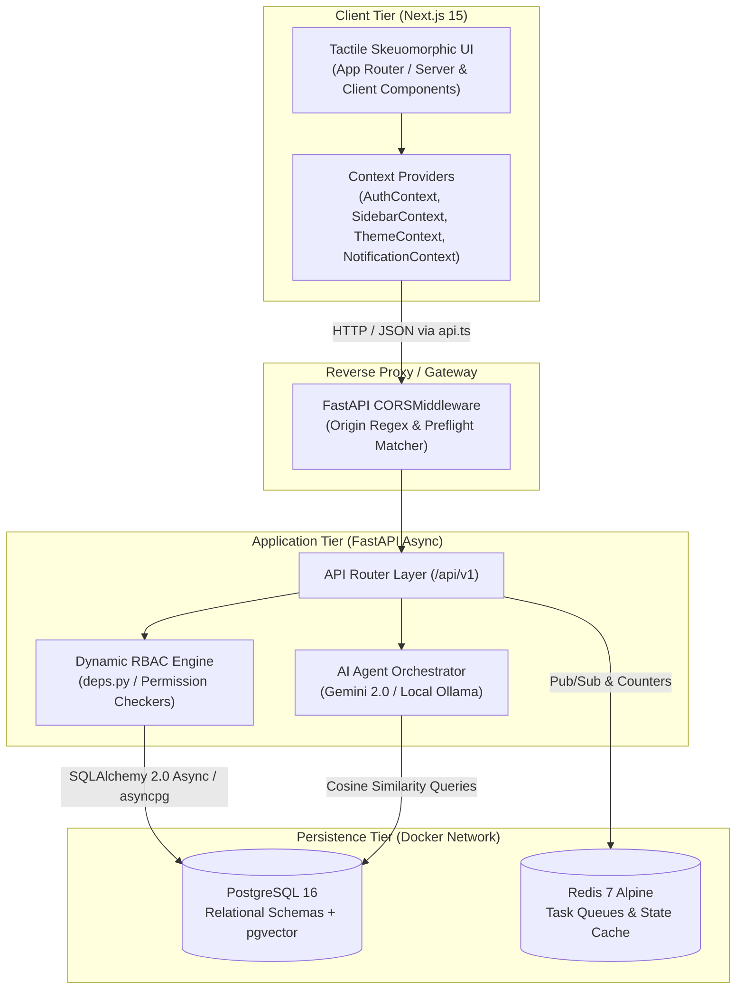

<div align="center">

# 🏛️ Apryde AI HRMS
### Enterprise Human Resource Intelligence & Autonomous Workforce Operations

[](https://fastapi.tiangolo.com)
[-black.svg?style=flat-square&logo=next.js&logoColor=white)](https://nextjs.org/)
[](https://github.com/pgvector/pgvector)
[](https://tailwindcss.com/)
[](https://www.docker.com/)
[](LICENSE)

<p align="center">
  A production-ready, full-stack Human Resource Management System engineered with dynamic database-level RBAC, two-tier approval state machines, automated shift roster calculations, an autonomous RAG policy assistant, and an intentional tactile skeuomorphic interface.
</p>

</div>

---

## 📌 Engineering Overview

Most modern open-source HRMS platforms fall into one of two traps: they are either legacy monoliths with rigid relational schemas, or superficial dashboards lacking atomic approval chains, auditable shift models, and genuine access control.

**Apryde AI HRMS** was engineered from the ground up to solve these fundamental operational problems:

1. **Strict Separation of Concerns**: Complete architectural split between Organizational Structure, Shift & Roster Planning, and Leave & Holiday Policies.
2. **Dynamic Database RBAC**: Decoupled from static code enums. Roles, hierarchy assignments, and granular JSON permission arrays (`permissions: ["*"]`, `["dashboard", "leaves", ...]`) are queried and enforced dynamically at runtime.
3. **State Machine Leave Approval**: Deterministic two-stage approval pipeline (`Reporting Line Manager` ➔ `HR Admin`) with zero self-approval privileges.
4. **Shift & Net Productive Hours Engine**: Automatically calculates actual working hours by subtracting configurable unpaid breaks, factoring in late-arrival grace buffers, half-day thresholds, and absenteeism boundaries.
5. **Human-in-the-Loop (HITL) AI Agent**: An autonomous assistant grounded on organization policy handbooks using `pgvector` semantic retrieval. High-stakes mutations (such as leave applications or approvals) generate visual confirmation cards before state commits.
6. **Tactile Soft UI Design Language**: A departure from flat, lifeless interfaces. Apryde uses physical depth tokens (`skeuo-card`, `skeuo-inset`, `skeuo-btn`, `skeuo-pill`) with smooth micro-interactions and dark/light mode balance.

---

## 🏛️ System Architecture



---

## ⚡ Core Functional Modules

### 1. Dynamic RBAC & Guardrail Engine
- **No Hardcoded Roles**: Traditional HRMS systems use static Python/TypeScript enums that require code deploys for every organizational change. Apryde stores roles directly in the `roles` table.
- **Granular Permission Arrays**: Every role carries a dynamic JSON array of permissions (`["dashboard", "employees", "attendance", "leaves", "payroll", "recruitment", "policies", "organization", "assets"]` or wildcard `["*"]`).
- **Runtime Enforcer**: Both API endpoints ([`backend/app/api/deps.py`](backend/app/api/deps.py)) and UI navigation guards ([`frontend/src/components/Sidebar.tsx`](frontend/src/components/Sidebar.tsx)) evaluate access in real time based on active database permissions.

### 2. Shift Master & Individual Employee Rostering
- **Shift Master**:
  - Pre-calibrated shifts: **General** (`09:00 - 18:00`), **Morning** (`06:00 - 14:30`), **Night** (`22:00 - 06:30`), and custom weekend shifts.
  - **Net Productive Calculation**: Unpaid break durations (e.g., 60 min) are deducted from gross duration to calculate actual productivity:
    $$\text{Net Hours} = \text{Gross Working Duration} - \text{Unpaid Break}$$
  - **Flexibility & Grace Windows**:
    - **Grace Time**: Allowed late-arrival window (e.g., 15 minutes) before marking attendance as late.
    - **Half-Day Threshold**: Minimum hours required to be credited for half a day (e.g., $< 4.0\text{h} \rightarrow \text{Half Day}$).
    - **Absenteeism Threshold**: Floor hours required for a day's presence (e.g., $< 2.0\text{h} \rightarrow \text{Absent}$).
- **Individual Employee Rostering**: Direct employee-to-shift assignment with date validity bounds, shift notes, and conflict-free calendar mapping.

### 3. Two-Tier Leave Workflow & Anti-Self-Approval
- **Two-Stage Sequential Pipeline**:
  ```
  [Employee Submits] ➔ [Stage 1: Reporting Manager] ➔ [Stage 2: HR Admin] ➔ [Leave Approved]
                                     ↓                              ↓
                              [Rejected]                    [Rejected]
  ```
- **Anti-Self-Approval Rule**: A manager or HR administrator cannot approve their own leave request. Self-requests are excluded from review queues and must be escalated to their respective reporting authority.
- **Quota & Balance Cards**: Real-time tracking of Allocated, Used, and Pending balances with instant carry-forward policy calculations.

### 4. Organization Structure & Tree Hierarchy
- **Company Profile**: Master corporate records (legal name, registration, tax identifiers, corporate headquarters).
- **Department & Team Topology**: Nested organization structure linking departments to specialized functional teams.
- **Visual Employee Tree**: An interactive, SVG-rendered reporting tree that visually illustrates the entire reporting hierarchy from executive leadership down to individual contributors.

### 5. Multi-Role Specialized Dashboards
Every authenticated role is routed to an optimized command center:
- **Employee Self-Service (ESS)**: Clock-in/out terminal, live timer, personal balances, payslips, and personal requests.
- **Team Manager Hub**: Direct report attendance radar, shift schedules, and pending team leave approvals.
- **HR Workforce Operations**: Headcount metrics, attrition rates, employee directory, and policy vault operations.
- **Recruitment & ATS**: Job requisition pipeline, candidate Kanban board, and semantic resume matching.
- **Payroll & Finance**: Monthly payroll runs, deductions, tax withholding, and salary disbursement records.
- **Super Admin Infrastructure**: Live Postgres container health, Redis task queues, and runtime LLM provider switching.

### 6. Tactile Skeuomorphic UI & Theme Engine
- Custom design tokens built with CSS custom properties:
  - `.skeuo-card`: Multi-layer shadow elevation with subtle inset border highlights.
  - `.skeuo-inset`: Debossed sunken wells for inputs, search bars, and active navigation pills.
  - `.skeuo-btn`: Tactile clickable buttons with micro-press animations (`active:scale-98`).
  - `.skeuo-pill`: Compact physical status badges.
- **Hydration-Safe Theme Switching**: Light and Dark mode with ambient glows and high-contrast color choices.
- **Responsive Navigation**: Synchronized sidebar via `SidebarContext`, accessible via a desktop navbar collapse toggle (`PanelLeftClose` / `PanelLeft`) and a mobile drawer with dedicated close actions.

---

## 🧰 Technology Stack

| Layer | Technology | Version | Purpose |
| :--- | :--- | :--- | :--- |
| **Frontend Framework** | [Next.js](https://nextjs.org/) | 15.x (App Router) | React Server & Client Components, Turbopack |
| **Client Core** | [React](https://react.dev/) | 19.x | Component lifecycle & responsive state management |
| **Styling** | [Tailwind CSS](https://tailwindcss.com/) | 4.x | Tactile skeuomorphic utility classes & tokens |
| **Icons** | [Lucide React](https://lucide.dev/) | Latest | Modern, clean vector iconography |
| **Backend Framework** | [FastAPI](https://fastapi.tiangolo.com/) | 0.110+ | Asynchronous RESTful API with automated OpenAPI docs |
| **Runtime / Language** | [Python](https://www.python.org/) | 3.11 | Modern typing, asyncio, and pattern matching |
| **ORM / Data Access** | [SQLAlchemy](https://www.sqlalchemy.org/) | 2.0 (Async) | Non-blocking async ORM queries with `asyncpg` driver |
| **Data Validation** | [Pydantic](https://docs.pydantic.dev/) | v2 | High-throughput schema validation and serialization |
| **Database** | [PostgreSQL](https://www.postgresql.org/) | 16 (Alpine) | Primary relational storage |
| **Vector Engine** | [pgvector](https://github.com/pgvector/pgvector) | 0.7+ | Dense vector embeddings for semantic RAG search |
| **Cache & Message Bus**| [Redis](https://redis.io/) | 7 (Alpine) | Session caching and async task queues |
| **AI LLM Orchestrator**| [Google Gemini](https://ai.google.dev/) / [Ollama](https://ollama.ai/) | Dual-Engine | Cloud (Gemini 2.0) and local on-premise inference |

---

## 📂 Repository Structure

```
├── .env.example                     # Environment template with sane defaults
├── docker-compose.yml               # Multi-container orchestration specification
├── backend/
│   ├── Dockerfile                   # Python 3.11 container specification
│   ├── requirements.txt             # Locked Python production dependencies
│   └── app/
│       ├── main.py                  # FastAPI bootstrap, CORS, and global error handling
│       ├── core/
│       │   ├── config.py            # Pydantic BaseSettings loading from .env
│       │   ├── database.py          # Async SQLAlchemy engine & session factory
│       │   └── security.py          # Password hashing (bcrypt) & JWT issuance
│       ├── models/                  # SQLAlchemy ORM database models
│       │   ├── user.py              # Dynamic User & Role relationships
│       │   ├── employee.py          # Employee, Department, and Designation records
│       │   ├── attendance.py        # Shift, Roster, and AttendanceRecord models
│       │   ├── leave.py             # LeaveRequest, LeaveBalance, and LeavePolicy
│       │   ├── organization.py      # CompanyProfile and Team models
│       │   └── asset.py             # Corporate hardware & asset lifecycle models
│       ├── schemas/
│       │   └── hrms.py              # Pydantic request & response serializers
│       ├── api/
│       │   ├── deps.py              # Auth & RBAC dependency injection guards
│       │   └── v1/                  # REST API endpoints (shifts, leaves, roles, etc.)
│       └── agents/
│           ├── llm_factory.py       # Dual provider (Gemini / Ollama) abstractions
│           └── orchestrator.py      # RAG retriever & autonomous tool executor
├── frontend/
│   ├── Dockerfile                   # Next.js node:20 container specification
│   ├── package.json                 # Node dependencies
│   ├── tailwind.config.ts           # Skeuomorphic styling tokens & theme extensions
│   └── src/
│       ├── app/                     # Next.js 15 App Router pages
│       │   ├── layout.tsx           # Root layout with Provider tree
│       │   ├── globals.css          # Skeuomorphic CSS variables and classes
│       │   ├── organization/        # Structure, Hierarchy, Shifts & Rosters
│       │   ├── leaves/              # Leave applications, balances & calendar
│       │   ├── attendance/          # Daily timesheets, clock-in & check-out
│       │   └── employees/           # Enterprise directory & management
│       ├── components/              # Reusable UI widgets & dashboards
│       │   ├── Navbar.tsx           # Global header with theme, collapse & user menu
│       │   ├── Sidebar.tsx          # Responsive, collapsible command navigation
│       │   ├── dashboards/          # 6 role-specific customized dashboards
│       │   └── notifications/       # Tactile notification dropdown & toast alerts
│       └── context/                 # React Context stores
│           ├── AuthContext.tsx      # User state, JWT storage & permission helpers
│           ├── SidebarContext.tsx   # Global persistent sidebar collapse state
│           ├── ThemeContext.tsx     # Light/Dark mode state with DOM syncing
│           └── NotificationContext.tsx # Unread alerts and polling system
└── docker/
    └── postgres/
        └── init-pgvector.sql        # Database initialization with vector extensions
```

---

## 🚀 Quick Start Guide

### 1. Prerequisites
- [Docker Engine](https://docs.docker.com/engine/install/) (v24.0+)
- [Docker Compose](https://docs.docker.com/compose/install/) (v2.20+)

### 2. Environment Configuration
Clone the repository and copy the example environment configuration:
```bash
git clone https://github.com/yashajaykadav/Human-Resource-Management-System.git
cd Human-Resource-Management-System

cp .env.example .env
```

Review `.env` to customize ports or credentials if needed:
- `FRONTEND_PORT=3001` (Frontend app)
- `BACKEND_PORT=8001` (FastAPI backend)
- `POSTGRES_EXTERNAL_PORT=5433` (Postgres host mapping)
- `REDIS_EXTERNAL_PORT=6380` (Redis host mapping)
- `GEMINI_API_KEY` (Optional: provide your key for cloud AI copilot)

### 3. Spin Up the Stack
Launch all services in isolated containers:
```bash
docker compose up --build -d
```

Verify service status:
```bash
docker compose ps
```

Once running:
- **Application Portal**: [http://localhost:3001](http://localhost:3001)
- **Interactive Swagger Docs**: [http://localhost:8001/api/v1/docs](http://localhost:8001/api/v1/docs)
- **ReDoc Documentation**: [http://localhost:8001/api/v1/redoc](http://localhost:8001/api/v1/redoc)
- **Backend Health Check**: [http://localhost:8001/health](http://localhost:8001/health)

---

## 👥 Seeded Authentication Matrix

The initial database seed provisions active accounts across every operational role for seamless testing:

| Role | Email | Password | Access Rights |
| :--- | :--- | :--- | :--- |
| **Super Admin** | `admin@apryde.com` | `admin123` | Full system access (`*`), DB settings & AI provider config |
| **HR Admin** | `hr@apryde.com` | `hr123` | Employee records, leave final approvals, ATS, policy vault |
| **Team Manager**| `manager@apryde.com` | `manager123` | Direct report rosters, timesheets, stage-1 leave approvals |
| **Employee (ESS)** | `employee@apryde.com` | `emp123` | Self profile, daily check-in, personal balance & leave apply |
| **Recruiter** | `recruiter@apryde.com` | `recruiter123` | Job requisitions, ATS applicant pipeline, resume scoring |
| **Payroll Specialist** | `payroll@apryde.com` | `payroll123` | Salary structures, payslip runs, tax withholdings |

---

## 🧪 Testing & Verification

Execute the backend automated test suite:
```bash
docker compose exec backend pytest -v
```

To run individual module tests:
```bash
docker compose exec backend pytest tests/test_hrms_core.py -v
docker compose exec backend pytest tests/test_agent_rbac.py -v
```

---

## 🤝 Contributing

Contributions, issues, and feature proposals are welcome!
1. Fork the Project
2. Create your Feature Branch (`git checkout -b feature/AmazingFeature`)
3. Commit your Changes (`git commit -m 'feat: Add some AmazingFeature'`)
4. Push to the Branch (`git push origin feature/AmazingFeature`)
5. Open a Pull Request

---

## 📄 License
Distributed under the **MIT License**. See [`LICENSE`](LICENSE) for more information.

<div align="center">
  <sub>Engineered with precision by <strong>Yash Ajay Kadav</strong>. Built for enterprise reliability.</sub>
</div>
